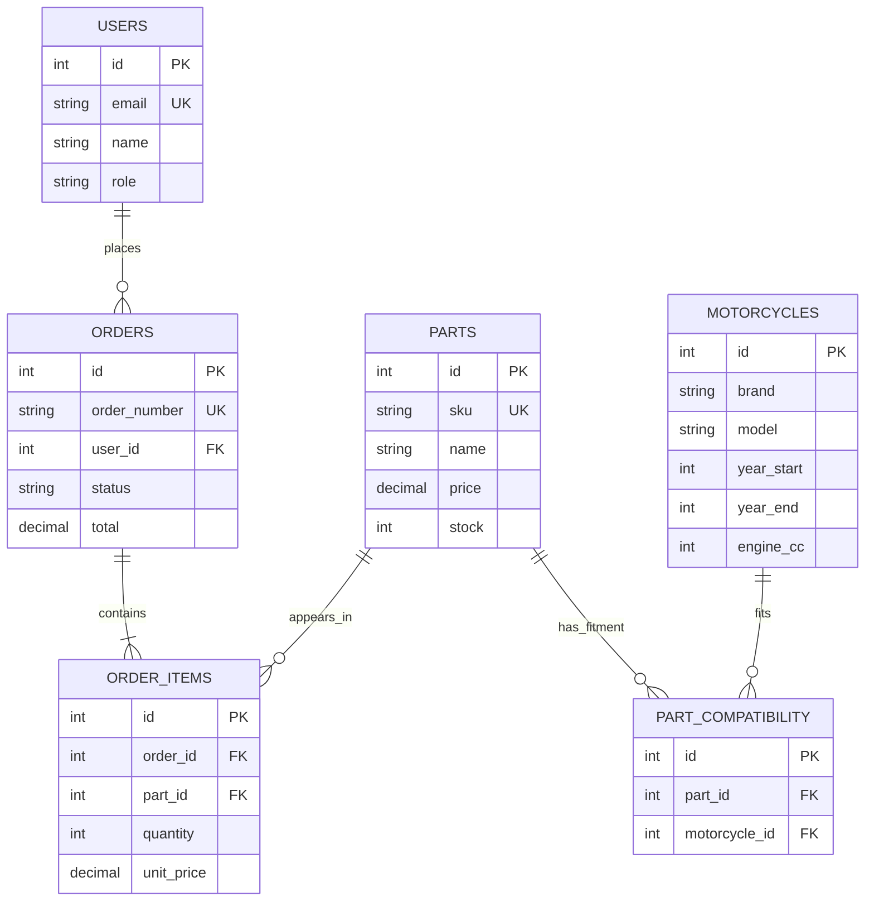

# MotoBuild Database Design Documentation

## A. System overview
**Title:** MotoBuild — Motorcycle Parts Compatibility and Ordering System.

**Problem:** Riders may buy parts that do not fit their motorcycle. MotoBuild lets a customer select a motorcycle, view demo-compatible parts, submit an order, and see whether an administrator approved it.

**Target users:** Customers/riders and an administrator.

**Modules:** Accounts, motorcycle catalog, parts catalog, compatibility search, order checkout, order tracking, admin approval, parts CRUD, JOIN report.

## B. Business rules
1. Each user has a unique email and one role (`customer` or `admin`).
2. A motorcycle can be compatible with many parts, and a part can fit many motorcycles; `part_compatibility` resolves this M:N relationship.
3. Each compatibility pair can appear only once.
4. One customer can place many orders; each order belongs to one customer.
5. Each order has one or more order items. An order item references one part and stores the quantity and price at purchase time.
6. Stock and price cannot be negative; order item quantity must be positive.
7. New orders begin as `pending`; an administrator decides whether to approve or reject them.
8. Rejecting/cancelling an order restores its reserved stock once.
9. The order number and SKU are unique.

## C. Sample unnormalized data (UNF)
A realistic unnormalized export might keep customer, motorcycle, parts, and repeated item data together:

| OrderNo | CustomerEmail | CustomerName | Bike | BikeYear | Items (repeating group) | Total | Status |
|---|---|---|---|---|---|---:|---|
| MB-001 | rider@example.com | Demo Rider | Honda Click 125i | 2022 | Brake Pads x1 @650; Mirror x1 @480 | 1130 | pending |
| MB-002 | ana@example.com | Ana Cruz | Yamaha Mio i 125 | 2021 | Mirror x2 @480 | 960 | approved |
| MB-003 | ben@example.com | Ben Santos | Honda Click 125i | 2023 | Brake Pads x2 @650 | 1300 | rejected |
| MB-004 | ana@example.com | Ana Cruz | Yamaha Mio i 125 | 2022 | Mirror x1 @480; Brake Pads x1 @650 | 1130 | pending |
| MB-005 | carlo@example.com | Carlo Reyes | Honda Click 125i | 2020 | Mirror x1 @480 | 480 | approved |
| MB-006 | rider@example.com | Demo Rider | Honda Click 125i | 2024 | Brake Pads x1 @650 | 650 | pending |
| MB-007 | dina@example.com | Dina Flores | Yamaha Mio i 125 | 2023 | Mirror x3 @480 | 1440 | approved |
| MB-008 | ben@example.com | Ben Santos | Honda Click 125i | 2021 | Brake Pads x1 @650; Mirror x1 @480 | 1130 | pending |
| MB-009 | edgar@example.com | Edgar Lim | Yamaha Mio i 125 | 2024 | Mirror x1 @480 | 480 | cancelled |
| MB-010 | ana@example.com | Ana Cruz | Yamaha Mio i 125 | 2025 | Mirror x2 @480 | 960 | pending |
| MB-011 | carlo@example.com | Carlo Reyes | Honda Click 125i | 2022 | Brake Pads x1 @650 | 650 | approved |
| MB-012 | dina@example.com | Dina Flores | Yamaha Mio i 125 | 2020 | Mirror x1 @480; Brake Pads x1 @650 | 1130 | pending |

**Problems:** the Items cell contains repeating groups; customer and motorcycle details repeat across orders; a price change can cause inconsistent historical records; edits can create update, insert, and delete anomalies.

## D. Normalization process
### UNF → 1NF
- Split every item into a separate row so each field holds one atomic value.
- Example: MB-001 becomes `(MB-001, rider@example.com, Honda Click 125i, MB-BRK-001, 1, 650)` and `(MB-001, rider@example.com, Honda Click 125i, MB-MIR-002, 1, 480)`.
- The flattened line-level key can be `(OrderNo, SKU)`.

### 1NF → 2NF
- In the flattened line table, attributes such as `CustomerEmail`, `CustomerName`, and `Status` depend only on `OrderNo`, while `PartName` and current `Category` depend only on `SKU`; they do not depend on the full composite key `(OrderNo, SKU)`.
- Split order-level data into `orders` and customer data into `users`; split part data into `parts`; retain line-specific `quantity` and `unit_price` in `order_items`.

### 2NF → 3NF
- Remove transitive dependencies: customer name/password/role belong to `users`, not `orders`; motorcycle brand/model/engine belong to `motorcycles`, not compatibility rows; part description/category/current stock belong to `parts`.
- The final relations are `users`, `motorcycles`, `parts`, `part_compatibility`, `orders`, and `order_items`. Foreign keys represent the relationships and uniqueness constraints prevent duplicate mappings.
- `order_items.unit_price` is a historical snapshot at the time of purchase, so it intentionally remains on the line item even if a part's current price changes.

## E. Final ER diagram


## F. Meaningful queries
### Query 1 — Compatible parts for a selected motorcycle (JOIN)
```sql
SELECT m.brand, m.model, p.sku, p.name, p.category, p.price, p.stock
FROM motorcycles m
JOIN part_compatibility pc ON pc.motorcycle_id = m.id
JOIN parts p ON p.id = pc.part_id
WHERE m.id = :motorcycle_id AND p.active = TRUE
ORDER BY p.name;
```
**Purpose:** display parts listed as compatible with a selected bike.

### Query 2 — Customer order report with item details (multi-table JOIN)
```sql
SELECT o.order_number, u.name AS customer, o.status, p.name AS part_name,
       oi.quantity, oi.unit_price, o.total, o.created_at
FROM orders o
JOIN users u ON u.id = o.user_id
JOIN order_items oi ON oi.order_id = o.id
JOIN parts p ON p.id = oi.part_id
ORDER BY o.created_at DESC;
```
**Purpose:** admin readable report linking the order, customer, and purchased part.

### Query 3 — Low-stock parts
```sql
SELECT sku, name, stock
FROM parts
WHERE active = TRUE AND stock <= 5
ORDER BY stock ASC;
```
**Purpose:** help admin identify items that may need restocking.

## G. Transaction scenario
**Place order:** stock is checked and decremented, then an order header and order item are inserted. These operations must succeed together. If creating the order item fails, rollback must undo the stock change and order insert. SQLAlchemy transaction handling is used in the route. PostgreSQL's `SELECT ... FOR UPDATE` row lock serializes stock reservation attempts for the same part.

## H. Concurrency scenario
Two customers might attempt to order the last available item simultaneously. The app obtains a row lock (`with_for_update`) and re-checks stock before decrementing. The stock column has a non-negative check constraint. This is most effective on PostgreSQL; SQLite is included for easy local demo and does not implement the same row-level locking behavior.

## I. CRUD demo checklist
- **Create:** register a user, place an order, or create a part from Admin.
- **Read:** browse parts and compatibility; inspect orders and JOIN report.
- **Update:** Admin edits part name, price, stock, active status; changes order status.
- **Delete:** Admin removes a part with no order history; referenced parts are archived instead to preserve order history.

## J. Suggested defense flow
1. Explain system purpose and target users.
2. State business rules and M:N fitment mapping.
3. Show UNF repeating groups and redundancy.
4. Explain 1NF atomic item rows.
5. Explain 2NF removal of partial dependencies.
6. Explain 3NF separation of customer, motorcycle, and part details.
7. Show ER diagram and PK/FK constraints.
8. Demonstrate browse, compatibility filter, checkout, order history.
9. Demonstrate admin approval and parts CRUD.
10. Run Query 1 and Query 2; explain the JOIN output.
11. Explain order transaction and rollback.
12. Explain last-item concurrency and row lock.
